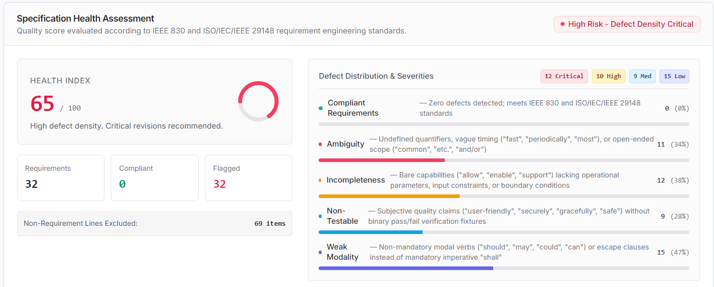
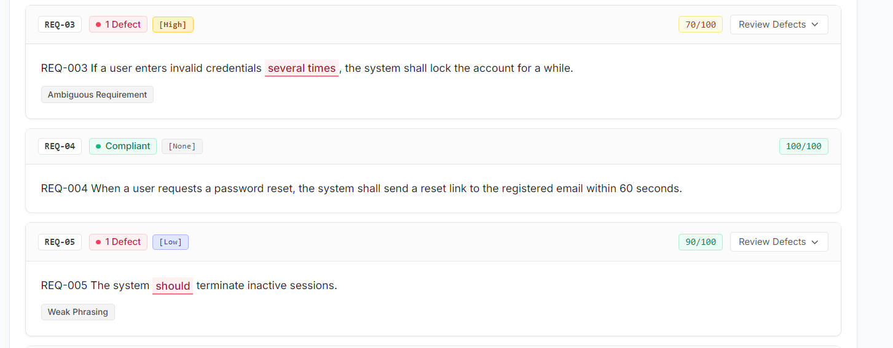
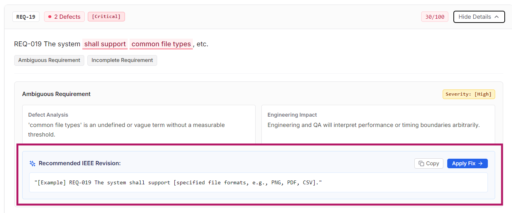
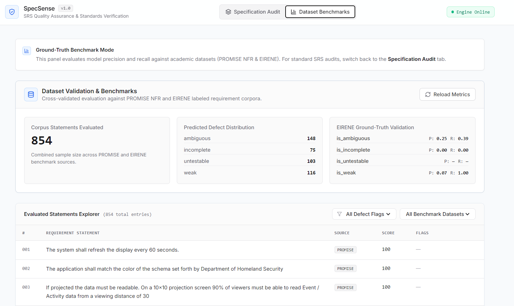
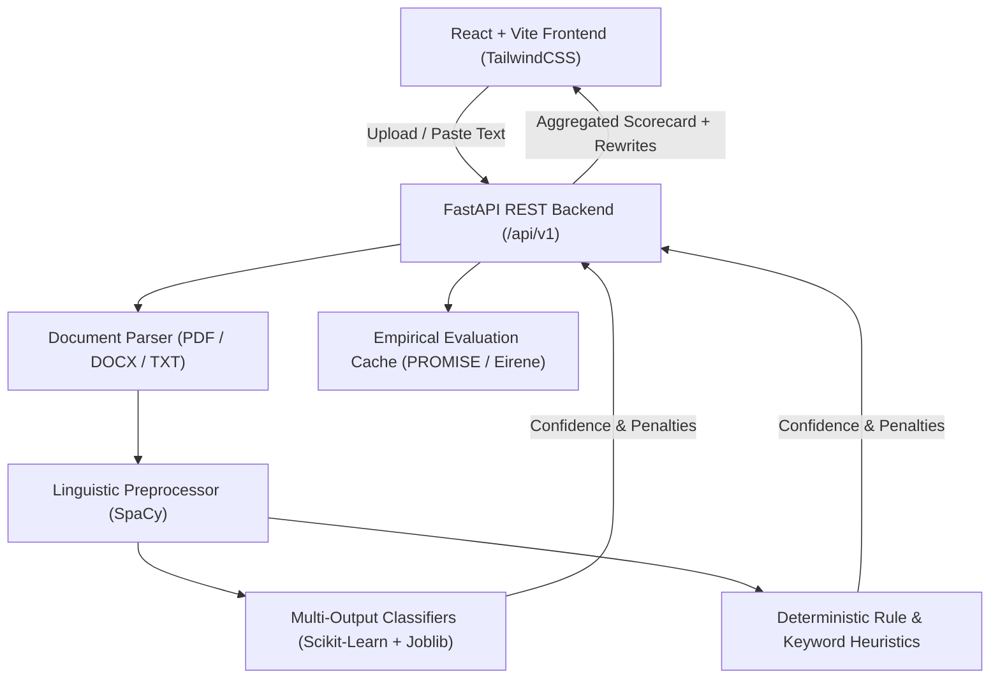

# SpecSense AI — Requirements Intelligence Engine

[](https://fastapi.tiangolo.com)
[](https://reactjs.org)
[](https://vitejs.dev)
[](https://scikit-learn.org)
[](https://spacy.io)
[](https://python.org)
[](LICENSE)

> **SpecSense AI** is an automated **Requirements Engineering Intelligence platform** that detects defects in Software Requirements Specifications (SRS), quantifies document health with an aggregate Risk Index, highlights flaw triggers, and generates targeted, testable rewrites in real time.

---

## Screenshots Showcase

### 1. Requirements Quality Dashboard & Live Scorecard
> Unified audit dashboard displaying project-level health score, risk categorization (Low / Moderate / Critical Risk), and categorized defect distribution.
<p align="center">
  
</p>

---

### 2. Deep Requirement Inspection & Flaw Trigger Highlighting
> Sentence-level parsing identifying exact linguistic defect triggers (`quickly`, `user-friendly`, `periodic`, `should`) with penalty scores, severity classification, and business risk explanations.
<p align="center">
  
</p>

---

### 3. In-Place Smart Rewrite & Quality Elevation
> Compare defective specifications side-by-side with recommended testable rewrites, with instant 1-click text replacement.
<p align="center">
  
</p>

---

### 4. Empirical Evaluation & Benchmark Panel
> Real-world benchmark against standard datasets (PROMISE_NFR & Eirene Annotated Corpora) showing empirical precision, recall, and detection metrics.
<p align="center">
  
</p>

---

## Evaluation & Limitations

The project score is driven by rule-based detections. ML-only flags are labeled **Advisory** and do not reduce the score. On the current EIRENE annotated set, ambiguity detection had **0.25 precision** and **0.39 recall** (199 annotated examples: 18 true positives, 54 false positives, and 28 false negatives). Weak-modality precision was **0.07** across 30 annotated examples (2 true positives and 28 false positives). Incompleteness had **no true positives** across 59 annotated examples (2 false positives and 7 false negatives). The current EIRENE set has no annotated examples for untestability, so that category has no real-data precision or recall result.

The classifiers were trained on synthetic requirements. These small real-data results show limited transfer to real SRS documents, especially for ambiguity, weak modality, and incompleteness. Future work is to train and validate with a larger, independently annotated set of real requirements.

---

## Key Capabilities

- 📄 **Multi-Format Ingestion**: Ingest and parse `.txt`, `.docx`, and `.pdf` SRS documents or paste freeform specifications directly into the analyzer.
- 🎯 **Multi-Label Defect Detection**:
  - **Ambiguity (`is_ambiguous`)**: Vague terms, subjective adjectives, indeterminate qualifiers (`fast`, `seamless`, `user-friendly`).
  - **Incompleteness (`is_incomplete`)**: Missing conditions, omitted system boundaries, vague placeholders (`TBD`, `etc.`).
  - **Untestability (`is_untestable`)**: Statements lacking measurable verification criteria or quantitative acceptance metrics.
  - **Weak Modality (`is_weak`)**: Passive voice or non-binding modals (`should`, `could`, `may`, `might` instead of deterministic `shall`).
- 📊 **Spec Health Score (0–100)**: Transparent weighted quality scoring system with category penalties and risk-level status badges.
- ✍️ **Actionable Rewrites**: Prescriptive recommendations and testable specification rewrites tailored to IEEE 830 / ISO 29148 standards.
- 📥 **Audit Export**: 1-click export of the entire defect breakdown into standardized `.csv` reports for QA and PM triage.

---

## Architecture



---

## Getting Started

### Prerequisites
- **Python 3.12.16** (see `.python-version`)
- **scikit-learn 1.7.1** (pinned in backend requirements for serialized model compatibility)
- **Node.js 18+ & npm**
- **Git**

---

### 1. Backend Setup

```bash
# Navigate to the backend directory
cd backend

# Create a virtual environment
python -m venv venv

# Activate virtual environment
# On Windows:
venv\Scripts\activate
# On Linux / macOS:
source venv/bin/activate

# Install Python dependencies
pip install -r requirements.txt

# Download required SpaCy language model (if using spaCy NLP pipeline)
python -m spacy download en_core_web_sm

# Launch the FastAPI development server
uvicorn app.main:app --reload --host 127.0.0.1 --port 8000
```
API Documentation will be live at:
- **Interactive Swagger Docs**: `http://localhost:8000/docs`
- **ReDoc**: `http://localhost:8000/redoc`
- **Health Check**: `http://localhost:8000/health` (also `/api/v1/health`)

---

### 2. Frontend Setup

```bash
# Navigate to the frontend directory
cd ../frontend

# Install dependencies
npm install

# Start the Vite development server
npm run dev
```
Open your browser and navigate to: **`http://localhost:5173`**

---

## Docker Compose Deployment

Run the backend and frontend in containers:

```bash
# Build and run all services in the background
docker compose up --build -d

# Check health and logs
docker compose logs -f
```
The application will be live at:
- **Frontend App**: `http://localhost:3000`
- **Backend API**: `http://localhost:8000`
- **Interactive Swagger Docs**: `http://localhost:8000/docs`

To shut down:
```bash
docker compose down
```

---

## Testing & CI

### Backend Unit & Integration Tests
```bash
cd backend
pytest tests/ -v
```

The backend runtime is pinned to Python 3.12.x and scikit-learn 1.7.1. The same versions are used in local setup and CI.

### GitHub Actions CI
Automated CI is pre-configured in [`.github/workflows/ci.yml`](.github/workflows/ci.yml) to automatically:
1. Lint and run test suites on Python 3.12
2. Build the production React bundle on Node 18

---

## API Endpoints Summary

| Method | Endpoint | Description |
| :--- | :--- | :--- |
| `GET` | `/health` | Short service health check alias |
| `GET` | `/api/v1/health` | Service health status & environment check |
| `POST` | `/api/v1/analyze-text` | Analyze raw requirements text string (with size validation) |
| `POST` | `/api/v1/analyze` | Parse and analyze uploaded SRS file (`.txt`, `.pdf`, `.docx`) |
| `POST` | `/api/v1/export/csv` | Generate downloadable analysis CSV report |
| `GET` | `/api/v1/evaluation/summary` | Retrieve model benchmark metrics against held-out datasets |
| `GET` | `/api/v1/evaluation/rows` | Query paginated benchmark rows with category filters |

---

## Tech Stack

- **Backend**: FastAPI, Uvicorn, Pydantic, Scikit-learn, SpaCy, Pandas, PyPDF, python-docx
- **Frontend**: React 18, Vite, Tailwind CSS, Lucide Icons
- **ML / NLP**: TF-IDF Vectorization, Multi-Output Binary Classifiers, Rule-Based Linguistic Lexicons
- **Datasets**: PROMISE NFR Held-out corpus, Eirene Annotated Requirement Dataset

---

## Contributing

Contributions are welcome!
1. Fork the Project
2. Create a feature branch (`git checkout -b feature/your-change`)
3. Commit your changes (`git commit -m 'Describe your change'`)
4. Push your branch (`git push origin feature/your-change`)
5. Open a Pull Request

---

## 📄 License

Distributed under the MIT License. See `LICENSE` for more information.
